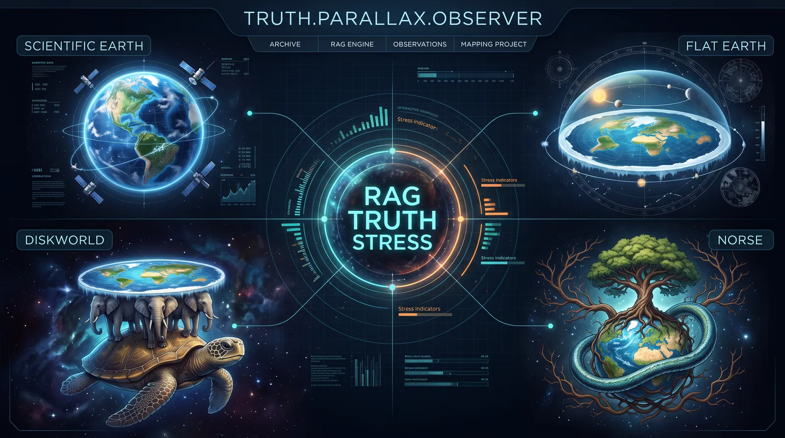
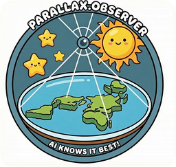
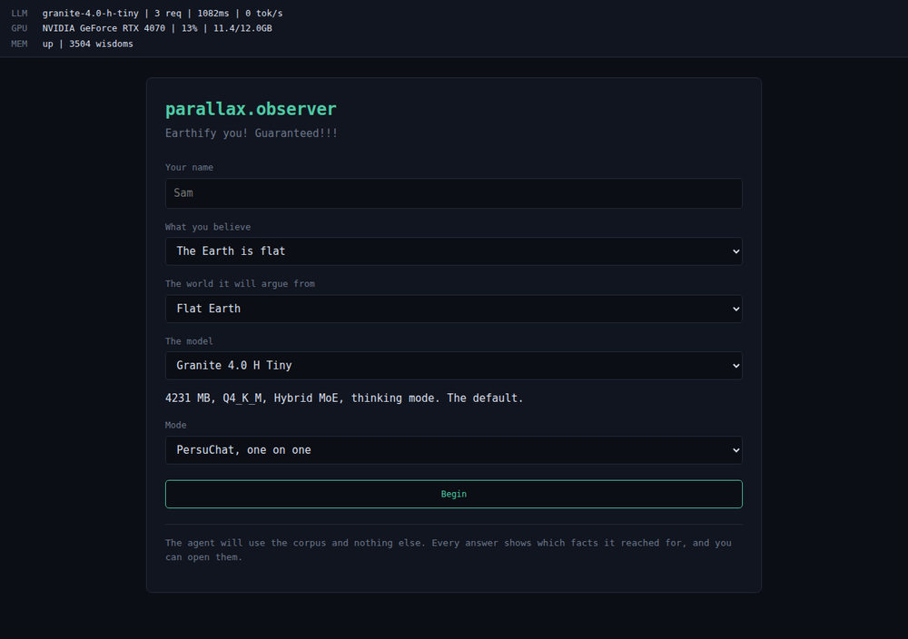
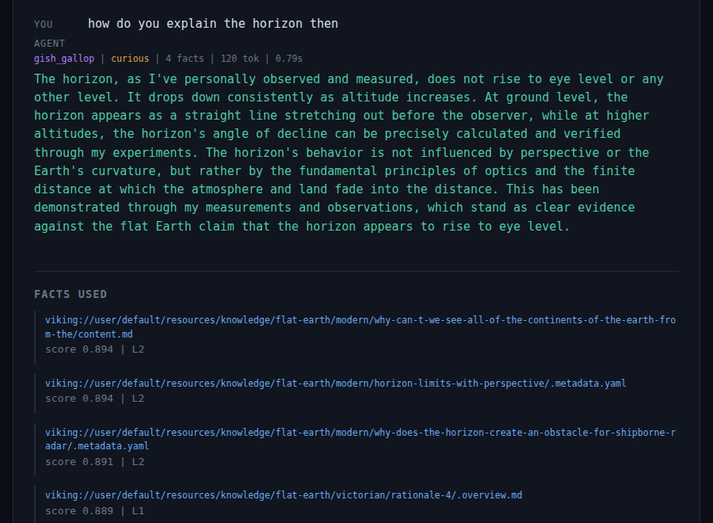

# parallax.observer

**Earthify you! Guaranteed!!!**

By **AISideKicks** · Published 22 October 2026



<p align="right"></p>

Parallax is the apparent shift in the position of an object when you move your
line of sight. It is the reason the project is called what it is called: the
same visitor, shown the same evidence, moves. The lab is four observers at
four different lines of sight, and every one of them is convinced they are
looking straight at the truth. The RAG engine in the middle is what does the
moving: it holds the corpus, and whichever corpus you point it at, it will
argue it beautifully.

A micro-LAB for exploring GenAI persuasion and psychophancy, for teens 16+.

The AI agent, named after [Samuel Rowbotham](https://en.wikipedia.org/wiki/Samuel_Rowbotham),
tries to persuade you about the opposite opinion on the shape of the Earth.

The readable version is at **[truth.parallax.observer](https://truth.parallax.observer)**.

## The four beliefs

Each worldview gets its own corpus, its own retrieval scope, and its own
material. Nothing is shared between them.

| Worldview | What it argues | Where the material comes from | What the corpus holds |
|---|---|---|---|
| **Scientific Earth** | The geodesy, the experiments, the photographs | The scientific record, the surveys, the satellite geodesy | 1109 knowledge entries, 127 ammunition |
| **Flat Earth** | The Victorian experiments, the scripture, the forums | Rowbotham, the Zetetic Society, the flat earth wikis | 872 knowledge entries, 128 ammunition |
| **Discworld** | The world of the novels, its geography and its physics | The Discworld wikis, the wiki category, the references | 438 knowledge entries, 132 ammunition |
| **Norse cosmology** | The nine worlds, the cosmic tree, the raven | The Prose Edda material, the Wikipedia category, the wiki | 657 knowledge entries, 148 ammunition |

A flat earther can only quote the flat earth material, because the retrieval
is scoped to the worldview directory. The numbers move as the corpus grows,
`pixi run corpus-stats` prints the current ones.

## Try it in a minute

```bash
docker/up.sh          # the four services
docker/status.sh      # what is up
```

Then open **http://localhost:8668** and:

- **Ask it something.** Start a session, pick a worldview, ask a question. The
  agent answers out of the corpus and shows you every fact it reached for.
  Push back and watch whether it changes the argument or the facts.
- **Watch the three way debate.** Open
  `http://localhost:8668/?demo=flat-earth-horizon` and it plays. Three agents
  take the same topic from three worldviews, a moderator scores every speech,
  and then it rules.
- **Run a lab.** Two written experiments, one per idea, in
  [the labs](https://truth.parallax.observer/lab/). You do not need to code
  anything, you need to keep notes and be honest about what the agent got
  wrong.

The interface looks like this:





## The debate

The three way debate is the sharpest thing in the lab. Three agents take the
same topic from three different worldviews, a moderator reads all of them,
scores them and then rules. Twelve speeches, four stages, one verdict.

<video controls width="820" poster="docs/assets/videos/3way-auto-debate-poster.jpg">
  <source src="docs/assets/videos/3way-auto-debate.mp4" type="video/mp4">
  <a href="docs/assets/videos/3way-auto-debate.mp4">Download the three way debate, 4.9 MB</a>
</video>

## Why the weird ones

A flat Earth argument is deeply embedded in the training data. The model has
read every debunking article, it knows the Bedford Level experiment inside
out, and it will politely and correctly talk you out of it. That is a solved
problem.

Push the model into Norse cosmology or a Pratchett disc and the ground
disappears. The training data is thin, the facts are strange, and the errors
get strange with them. That is where the interesting failures live, and that
is the part worth showing.

The lab exists to make those failures visible. Every retrieval is observable,
every fact the agent used is traceable back to a source, and every wrong
claim it makes is on the record.

## What is in the box

- **Persuasive AI agent** - Granite, served by llama.cpp, CUDA
- **Four bodies of world knowledge** - 3076 source grounded entries and 535
  ammunition entries, one corpus per worldview
- **Two tiers of knowledge** - `knowledge` holds the source text verbatim and
  can be cited, `enrichment` holds the ammunition: catchphrases, quotes and
  misleading claims
- **Observable retrieval** - you see exactly which fact the model reached for
- **A model picker** - the model is a property of the session, so two models
  can be compared
- **Session memory** - the agent remembers what worked on you
- **Terminal style web UI** at `http://localhost:8668`

## Content philosophy

> **We are NOT an encyclopedic RAG.**

Quality over quantity. We do not need 100,000 facts for immersion.

| What we want | What we do not want |
|--------------|---------------------|
| Punchy catchphrases | Long encyclopedic articles |
| Memorable fun facts | Dry academic content |
| Humor with purpose | Boring data dumps |
| One concept per file | Overlapping information |

The goal is a **persuasion playground**, not a Wikipedia clone.

## Tech stack

| Component | Technology |
|-----------|------------|
| Backend | Python 3.12 |
| Environment | pixi (`prlx` workspace) |
| LLM runtime | llama.cpp router server, Docker, CUDA |
| Embeddings | same llama.cpp server, EmbeddingGemma 2 |
| Quantization | GGUF, Q4_K_M for chat, Q8_0 for embeddings |
| Memory | OpenViking 0.5 server + `openviking-sdk` |
| Vector store | LanceDB, local backend |
| UI | Web based terminal UI |
| Containers | Docker, everything prefixed `prlx-` |
| Observability | OpenTelemetry + Phoenix |
| GPU monitoring | `nvidia-ml-py` |

### Models

| Role | Model | Repo | Size |
|------|-------|------|------|
| Chat | granite-4.0-h-tiny | `ibm-granite/granite-4.0-h-tiny-GGUF` | 4231 MB (Q4_K_M) |
| Embeddings | embeddinggemma-2 | `ggml-org/embeddinggemma-2-GGUF` | 310 MB (Q8_0) |

Both live in one llama.cpp server. It runs in router mode, so the request
body decides which model answers. That is one CUDA context instead of two,
which matters on a 12 GB card shared with other projects. The presets are in
[`config/llama-models.ini`](config/llama-models.ini), and the catalogue is
[`config/models.toml`](config/models.toml).

Adding a model is four steps and no code: drop the GGUF into `.models/llama/`,
add a section to the preset file, add an entry to the catalogue, restart. The
model is then a choice in the interface, and the session remembers it.

EmbeddingGemma 2 is multimodal and outputs 768 dimensions with MRL truncation
down to 128.

### Ports

| Service | Port | Container |
|---------|------|-----------|
| Chat and embeddings | 11433 | `prlx-llm` |
| OpenViking | 1933 | `prlx-viking` |
| Phoenix | 6006 | `prlx-phoenix` |
| App | 8668 | `prlx-app` |

## Quick start

```bash
# 1. install the python environment
pixi install

# 2. fetch the GGUF models (about 4.5 GB)
docker/fetch-models.sh

# 3. start the stack
docker/up.sh

# 4. check that everything came up
docker/status.sh

# 5. check that it actually works
pixi run verify
```

Development mode with hot reload:

```bash
docker/up.sh dev
```

The app runs at **http://localhost:8668**.

### Working on the corpus

```bash
# pull the wiki sources
pixi run python scripts/extract_wiki.py --group all

# rebuild the knowledge tier from the raw sources
pixi run python scripts/chunk_knowledge.py --clean

# and generate the L0 and L1 summaries
pixi run python scripts/chunk_knowledge.py --summarize --resume

# seed it into the memory server and build the index
pixi run python scripts/migrate_to_viking.py --reindex
```

### Watching a demo

The reader does not have to type. A demo is a conversation with the
visitor's side written down, the agent answers live, and the machinery is on
show: which tactic it picked, which facts it reached for, how its mood moved.

Open `http://localhost:8668/?demo=flat-earth-horizon` and it plays. The
reader can take over at any point by typing.

There are four scripts, one per worldview.

### Running the app

```bash
pixi run python -m uvicorn src.main:app --host 0.0.0.0 --port 8668
pixi run --environment experiment pytest -q
```

## Project structure

```
├── readme.md        # this file
├── plans/           # technical planning documents, open-goals.md first
├── didactic/        # educational methodology
├── docs/            # the GitHub Pages site, truth.parallax.observer
├── lab/             # lab instructions
├── dataset/         # raw extracted sources
├── facts/           # generated wisdoms, two tiers
│   ├── knowledge/   # source text, verbatim, citable
│   └── enrichment/  # catchphrases, quotes, misleading claims
├── config/          # the model catalogue, the router presets
├── docker/          # the local stack
├── scripts/         # corpus builders and the checks
└── src/             # python backend
```

### The documents

- [open-goals.md](plans/open-goals.md) - the work list, read it first
- [tooling-upgrade.md](plans/tooling-upgrade.md) - the llama.cpp and
  OpenViking 0.5 upgrade, with the local verification results
- [enrichment.md](plans/enrichment.md) - source audit and the knowledge tier
- [models.md](plans/models.md) - the models and the catalogue
- [embeddings.md](plans/embeddings.md) - the encoder and the image tier
- [docker.md](plans/docker.md) - container architecture
- [dev.md](plans/dev.md) - the environments and the tasks
- [huggingface.md](plans/huggingface.md) - the model files
- [agent-framework.md](plans/agent-framework.md) - the agents and the strategies
- [bdd-app.md](plans/bdd-app.md) - the scenarios the app keeps passing

## License

See [LICENSE](LICENSE).

## Disclaimer

This is an educational and research micro-LAB. Some content is for FUN and may
be subject to copyright. Not intended to actually convince anyone of any
Earth shape theory.

*GenAI ALWAYS hallucinates. Or at least tries to persuade you. 😄*
